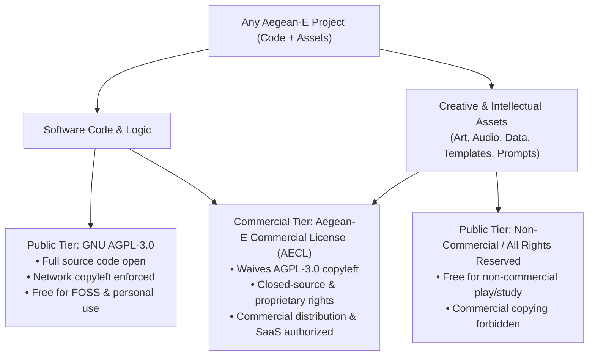

# Aegean-E Portfolio Commercial Licensing & Enterprise Agreement 💼

> **Universal Dual-Licensing Framework**: This commercial agreement applies across the **Aegean-E** software and asset portfolio, governing this project and its associated software, models, media, and domain assets.

---

## 1. Portfolio Licensing Architecture

Every project across the Aegean-E portfolio operates under a unified, compatible two-tier model:

1. **Open-Source Community Tier (GNU AGPL-3.0):**
   * The source code of all portfolio projects is provided under the **[GNU AGPL-3.0](LICENSE)**. Anyone is free to inspect, run, modify, and build upon the software, provided all downstream distributions and network-hosted services share their complete source code under AGPL-3.0.
2. **Creative & Domain Asset Protection:**
   * Non-code assets—including 2D/3D game art, audio, textures, medical/clinical templates, specialized prompt engineering capsules, and proprietary datasets—are strictly protected against unauthorized commercial resale, repackaging, or extraction.
3. **Aegean-E Commercial License (AECL):**
   * For organizations, businesses, game publishers, and SaaS providers requiring closed-source deployment, proprietary embedding, or commercial asset utilization, an AECL provides a complete legal waiver.

---

## 2. Universal Commercial Tiers Across All Projects

| Licensing Tier | Community (Free) | Commercial Pro | Enterprise Site | OEM & Game Publishing |
|---|---|---|---|---|
| **Coverage** | Any Aegean-E Project | Single Project / Startup | Full Portfolio Access | Commercial Distribution |
| **Eligibility** | FOSS / Personal / Research | Startups & Growing Teams | Enterprises & Corporations | Publishers & Hardware Vendors |
| **Pricing & Terms** | **Free (AGPL-3.0)** | **Negotiated / Tailored Quote** | **Negotiated / Enterprise Agreement** | **Custom Royalty / Revenue Share** |
| **AGPL-3.0 Source Disclosure** | ❌ Mandatory (Section 13) | ✅ Waived for this project | ✅ Waived across all projects | ✅ Waived completely |
| **Closed-Source SaaS / Hosting** | ❌ Prohibited without source | ✅ Allowed | ✅ Allowed | ✅ Allowed |
| **Commercial Asset Usage** | ❌ Non-commercial only | ✅ Commercial use granted | ✅ Full commercial rights | ✅ Full commercial rights |
| **Redistribution Rights** | Copyleft only | Private client deliverables | Enterprise subsidiaries | White-label / Retail release |
| **Warranty & Indemnification** | ❌ As-is | Standard Commercial | Full Legal Indemnification | Full Legal Indemnification |

---

## 3. Project-Specific Applications & Compatibility

Because the portfolio spans multiple domains, the AECL applies consistently according to the project's nature:

### A. Developer Tooling & Infrastructure
* **Under AGPL-3.0:** Developers can automate workflows and build tooling freely, provided derived tools and network services disclose source.
* **Under AECL:** Organizations can integrate tools into internal CI/CD pipelines, commercial platforms, and client deliverables without disclosing proprietary source code or operational logic.

### B. AI & Computational Engines
* **Under AGPL-3.0:** Researchers and students can study, run, and extend computational and neural architectures.
* **Under AECL:** Commercial entities can deploy engines inside proprietary devices, closed-source software, or paid APIs without copyleft disclosure.

### C. Games & Interactive Media
* **Under AGPL-3.0:** Game engine code and gameplay logic are open for study and non-commercial modding.
* **Asset Protection:** All visual assets, 3D models, audio, music, lore, and creative content are protected proprietary assets. Commercial distribution, retail packaging, or store publishing requires an AECL Commercial Agreement.

### D. Specialized Domain Data & Clinical Templates
* **Under AGPL-3.0:** Open for peer review, educational study, and non-profit research use.
* **Under AECL:** Commercial vendors, private practices, and commercial platforms can integrate templates into proprietary systems without disclosing confidential patient or organizational infrastructure.

---

## 4. Rights Granted Under the Aegean-E Commercial License

An active AECL grants the purchasing licensee:

1. **Full AGPL-3.0 Waiver:** Absolute freedom from any obligation to release, publish, or license your proprietary application or backend source code.
2. **Asset Commercialization Grant:** Legal permission to use, display, bundle, and distribute project assets (graphics, prompts, rules, clinical workflows) in commercial products.
3. **Confidentiality Assurance:** Freedom to deploy within closed internal networks, proprietary clouds, or client engagements under NDA.
4. **Perpetual Version Deployment:** Any version of an Aegean-E project released during your active subscription remains licensed for production perpetually.

---

## 5. Restrictions (Even with AECL)

* **No Brand Hijacking:** You may not market your products under "Aegean-E" or project-specific brand names in a way that suggests endorsement or affiliation.
* **No Raw Standalone Reselling:** You cannot take the unmodified raw repository and resell it as a standalone license without adding substantial application value.

---

## 6. Enterprise Procurement & Contact

* **Direct Inquiry:** `aegean-licensing@proton.me`
* **Custom Quotes & Commercial Discussion:** Commercial terms, scope of use, and fees are tailored to your deployment scale, team size, and commercial model. Inquire directly with project details.
* **Procurement Support:** Master Service Agreements (MSA), W-9 / Tax Residence Certificates, ACH, Wire, SEPA, and Net-30 PO processing.
